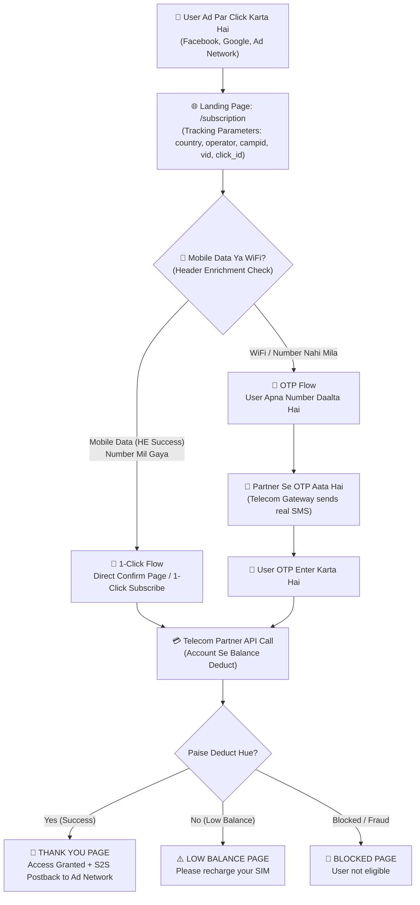

# Project Overview: Telecom WAP Carrier Billing & Dynamic Funnel Builder

> **Document Type:** High-Level Product & System Blueprint  
> **Target Audience:** Developers, Product Managers, Founders & Non-Tech Stakeholders  
> **Language:** Hinglish (Hindi + English) + Clean Diagrams  

---

## 1. Yeh Project Asal Me Kya Hai? (Non-Tech Explanation)

Simple shabdon me kahein toh yeh ek **Mobile Subscription & Carrier Billing Platform (WAP Manager)** hai.

### Real-Life Analogy (Aam Zindagi Ka Example)
Jab aap Netflix ya Amazon Prime ka subscription lete ho, toh aap apna **Credit/Debit Card** ya **UPI** use karte ho. 

Lekin bohot saare countries (jaise Middle East — UAE, Saudi Arabia, ya Africa — Kenya, South Sudan, Burkina Faso) me sabhi logon ke paas credit cards ya bank accounts nahi hote. Wahan log apne **Mobile SIM Balance (Prepaid Recharge / Postpaid Bill)** se payment karte hain. Isse tech industry me **Carrier Billing (DCB - Direct Carrier Billing) ya WAP Billing** kaha jata hai.

### Hamara Software Kya Kaam Karta Hai?
1. **Ad Traffic Aata Hai:** Digital marketing agencies / Affiliates Facebook, Google, ya Ad Networks par ads chalate hain (e.g. *"Play 500+ Games"* ya *"Get Daily Fitness Tips"*).
2. **User Link Par Click Karta Hai:** User hamare landing page (`/subscription?...`) par land karta hai.
3. **Automatic Number Detection (HE - Header Enrichment):** Agar user mobile data (3G/4G/5G) par hai, toh telecom operator background me hi uska mobile number (MSISDN) detect kar leta hai. User ko number type bhi nahi karna padta!
4. **Agar WiFi Par Hai (OTP Flow):** Agar mobile data nahi hai, toh user apna number enter karta hai, uske phone par OTP aata hai, aur OTP verify hote hi subscription confirm ho jata hai.
5. **Telecom Operator Se Paise Deduct:** Telecom partner (Zain, Etisalat, MTN, Safaricom) user ke balance se paise (e.g. 5 AED/week) deduct kar leta hai.
6. **Ad Network Ko Conversion Postback:** Ad network ko signal (Postback) chala jata hai ki *"Conversion successfully ho gaya, publisher ko commission de do"*.
7. **Visual Funnel Builder (Admin Canvas):** Admin bina kisi coder ki help ke GrapesJS drag-and-drop editor se kisi bhi offer ka design (Home, OTP page, Confirm page, Thank you page) khud bana sakta hai aur buttons ke click actions set kar sakta hai.

---

## 2. Pura System Kaise Kaam Karta Hai? (The Big Picture)

---

## 3. Core Terminology (Jo Har Kisi Ko Pata Honi Chahiye)

| Term | Matlab (Simple Hindi-English) |
| :--- | :--- |
| **MSISDN** | User ka mobile phone number with country code (e.g., `971501234567`). |
| **HE (Header Enrichment)** | Telecom network jab user ke HTTP request me secretly mobile number inject kar deta hai, jisse bina user se puche number mil jata hai. |
| **DCB (Direct Carrier Billing)** | Phone balance se direct payment katna. |
| **Vendor / Network** | Jo hume traffic (ad visitors) bhejta hai (e.g., PropellerAds, Mobidea). |
| **Affiliate** | Vendor ke andar ka sub-publisher jiska traffic aa raha hai (`aff_id`). |
| **Campid / Tracking ID** | Har campaign ka unique code (e.g., `AE-ETISALAT-101`), jisse system ko pata chalta hai kaunse country aur operator ka offer chalana hai. |
| **Postback (S2S)** | Server-to-Server web call jo hum ad network ko bhejte hain jab conversion ho jata hai, taaki ad network apna report update kar sake. |
| **Verification Mode** | Campaign kis raste se chalega: `HEADER_INJECTION` (Sirf HE), `OTP_ONLY` (Sirf OTP), ya `BOTH` (HE mila toh 1-click, nahi toh OTP). |
| **GrapesJS Canvas** | Web browser ke andar visual drag-and-drop designer jahan se landing page ka look-and-feel banaya jata hai. |

---

## 4. Purane Project Me Kya Mess Tha? (Why We Are Rebuilding Clean)

Purane project me kaafi acche features the, lekin samay ke sath code me teen alag-alag logic aapas me mix ho gaye the ("Kichdi" ban gayi thi):

1. **Triple Source of Truth (Confusion):**
   - Ek taraf Detect Logic alag faisla kar raha tha.
   - Dusri taraf Flow Builder (Graph nodes/edges) alag faisla kar raha tha.
   - Teesri taraf Canvas button ke click settings alag direction me le ja rahe the.
2. **Monolithic & Giant Files:** Ek hi file me 300 se 500 lines ka code tha, jisme state, API calls, DOM manipulation, aur routing sab mix the.
3. **Non-Tech Unfriendly:** Koi naya developer ya product manager code dekh kar yeh nahi samajh pata tha ki agar button dabaya toh aage kya hoga.

### Clean Rebuild Ka Solution (Hamari Strategy)
- **Layered Architecture:** Har kaam ka ek single, well-defined owner hoga.
- **Micro Files:** Koi bhi file 150-200 lines se badi nahi hogi.
- **Single Source of Flow Truth:** Campaign Detail page par ek clear mode select hoga (`BOTH`, `OTP_ONLY`, `HEADER_INJECTION`). Canvas buttons bas standard actions call karenge (`SUBSCRIBE`, `GOTO_PAGE`, `EXTERNAL_URL`).
- **Complete Visual Spec:** Har screen aur state ka ek figma-like interactive blueprint hoga jisse koi bhi visual flow samajh sake.

---

## 5. Blueprint Folder Structure (Is Guide Me Kya-Kya Shamil Hai)

Humne is naye blueprint folder (`rebuild-blueprint/`) me saare documents ko alag-alag modules me divide kiya hai:

1. [01-PROJECT-OVERVIEW.md](file:///d:/dddd/rebuild-blueprint/01-PROJECT-OVERVIEW.md) — (Current Doc) Project ka high-level business aur practical overview.
2. [02-NON-TECH-ARCHITECTURE-AND-CLEAN-CODE.md](file:///d:/dddd/rebuild-blueprint/02-NON-TECH-ARCHITECTURE-AND-CLEAN-CODE.md) — Clean code structure, mental model, aur non-tech architectural diagrams.
3. [03-BACKEND-SPECIFICATION.md](file:///d:/dddd/rebuild-blueprint/03-BACKEND-SPECIFICATION.md) — Express/Node backend ke modules, API contracts, aur services ka deep-dive.
4. [04-FRONTEND-SPECIFICATION.md](file:///d:/dddd/rebuild-blueprint/04-FRONTEND-SPECIFICATION.md) — React frontend, state management, aur **Figma-style Interactive Play Prototype Prompt**.
5. [05-DATABASE-SCHEMA.md](file:///d:/dddd/rebuild-blueprint/05-DATABASE-SCHEMA.md) — Complete database tables, relationships, indexes, aur ER diagram.
6. [06-STEP-BY-STEP-BUILD-ROADMAP.md](file:///d:/dddd/rebuild-blueprint/06-STEP-BY-STEP-BUILD-ROADMAP.md) — Scratch se step-by-step code karne ka complete day-by-day roadmap.

Inhe step-by-step follow karke aap is project ko ek ultra-clean, enterprise-grade SaaS platform ke roop me bana sakte hain.
