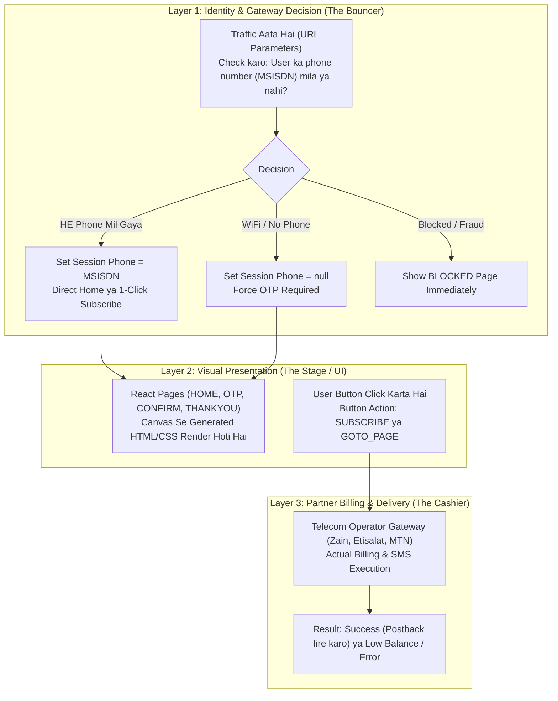
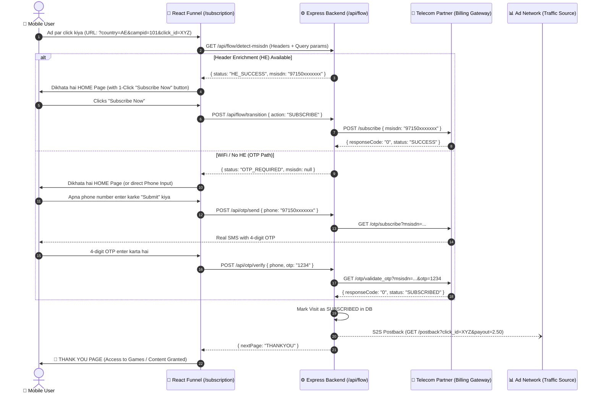

# Architecture & Clean Code Standards (Non-Tech Friendly)

> **Document Type:** System Architecture & Clean Engineering Guidelines  
> **Key Focus:** Clean mental model, zero spaghetti code, modular files (under 150-200 lines), non-tech friendly clarity.

---

## 1. The Clean Mental Model: 3 Saaf Layers (No More Kichdi!)

Purane system me jo sabse badi dikkat thi woh thi ki **Detect, Routing, aur Canvas Actions** aapas me ulajh gaye the. Clean architecture me hum isko **3 alag-alag layers** me baantte hain:



### Simple Rules For Each Layer:
1. **Layer 1 (The Bouncer - Detect Engine):** Iska kaam sirf yeh tay karna hai ki user ko andar aane dena hai ya nahi, aur kya uska phone number network se automatically mil gaya (HE) ya nahi. Iska visual design se koi lena-dena nahi hai.
2. **Layer 2 (The Stage - Frontend Pages):** Yeh sirf screen dikhata hai (`HOME`, `OTP`, `CONFIRM`, `THANKYOU`). Jab user CTA button dabata hai, yeh bas ek event fire karta hai: *"Hey Backend, user wants to SUBSCRIBE with this phone number!"*.
3. **Layer 3 (The Cashier - Partner Service):** Yeh backend ka worker hai jo Telecom Operator ke API se baat karke paise deduct karwata hai aur agar user valid hai toh usko Thank You page par bhejta hai.

---

## 2. End-to-End Sequence Diagram (Kaise Data Flow Hota Hai)

Ek non-tech person ke liye poori journey niche diye sequence diagram me asani se samjhi ja sakti hai:



---

## 3. Clean Code Rules: Code Kabhi Messy Aur Lamba Na Ho

Purane codebase me functions 200 lines ke the aur files 500+ lines ki. Naye project me hum **Strict Coding Rules** follow karenge:

### Rule 1: 150-200 Lines Per File Limit (Strict Rule)
- Koi bhi JavaScript ya React file **200 lines se badi nahi hogi**.
- Agar koi file 180 lines cross karne lage, toh turant logic ko chote `helpers/`, `services/`, ya `hooks/` me split karo.

### Rule 2: Single Responsibility Principle (Ek File, Ek Kaam)
- **Routes File (`*.routes.js`):** Sirf paths aur middleware batayega (10-30 lines). Business logic bilkul nahi hoga.
- **Controller File (`*.controller.js`):** Sirf request se data nikalega (`req.body`), service ko dega, aur response bhejega (`res.json`). Maximum 40-70 lines.
- **Service File (`*.service.js`):** Saara business logic, database queries, aur calculations yahan honge.
- **Helper File (`helpers/*.js`):** Chote reusable calculation functions (e.g., phone format karna, tracking ID parse karna).

### Rule 3: Frontend "Smart Hook + Dumb Component" Pattern
- **UI Components (Dumb):** React components sirf HTML aur styling render karenge. Unke andar koi lamba API logic nahi hoga.
- **Custom Hooks (Smart):** Saara API call, timer, aur validation logic alag hook file me rahega (e.g., `useOtpHandler.js`, `useSubscriptionFlow.js`).

### Rule 4: Self-Descriptive Naming (No Guesswork)
- Variables ke naam itne saaf hone chahiye ki bina comment padhe samajh aa jaye:
  - ❌ `const res = await chk(p);` (Ganda code)
  - ✅ `const partnerCheckResponse = await partnerBillingService.checkSubscription(msisdn);` (Saaf code)

---

## 4. Ideal Folder Structure (Scratch Rebuild Blueprint)

### Backend Structure (`/backend`)
```
backend/
├── src/
│   ├── app.js                   # Express app config (CORS, JSON parser) < 50 lines
│   ├── server.js                # Port listener & DB connect < 40 lines
│   ├── config/                  # Environment variables & constants
│   ├── database/
│   │   ├── connection.js        # DB connect instance (TypeORM / Prisma)
│   │   └── entities/            # Har table ka alag schema file (Clean & Typed)
│   ├── middlewares/             # Auth JWT guard, Error handler, Rate limiter
│   ├── modules/                 # Modular micro-features (Self-contained)
│   │   ├── auth/                # Login, signup, JWT
│   │   ├── markets/             # Countries & Operators management
│   │   ├── campaigns/           # Campaign creation & offer configuration
│   │   ├── templates/           # GrapesJS HTML/CSS storage
│   │   ├── partners/            # Vendors & Affiliates management
│   │   ├── flow/                # /detect-msisdn, /page, /transition
│   │   │   ├── flow.routes.js
│   │   │   ├── flow.controller.js
│   │   │   ├── flow.service.js
│   │   │   └── helpers/         # he-resolver.js, tracking-parser.js
│   │   ├── otp/                 # Partner OTP send/verify + local mock
│   │   └── analytics/           # Visit tracking, conversions, postbacks
│   └── utils/                   # logger.js, http-client.js, response.js
```

### Frontend Structure (`/frontend`)
```
frontend/
├── src/
│   ├── main.jsx                 # App entry point
│   ├── app/                     # App router & layout shell
│   ├── assets/                  # Logos, icons, default graphics
│   ├── components/              # Reusable UI widgets (Buttons, Modals, Tables)
│   ├── pages/
│   │   ├── admin/               # Admin Portal Pages
│   │   │   ├── DashboardPage.jsx
│   │   │   ├── MarketsPage.jsx
│   │   │   ├── CampaignsPage.jsx
│   │   │   ├── CampaignDetailPage.jsx
│   │   │   └── VisualEditorPage.jsx (GrapesJS Canvas)
│   │   └── subscription/        # Public End-User Landing (/subscription)
│   │       ├── SubscriptionPage.jsx     # Master container (< 100 lines)
│   │       ├── hooks/                   # useDetect.js, useOtpFlow.js, usePageRenderer.js
│   │       └── components/              # PhoneInput.jsx, OtpModal.jsx, StatusCard.jsx
│   ├── services/                # Axios API callers (adminApi.js, flowApi.js)
│   ├── store/                   # Zustand stores (useAuthStore.js, useFunnelStore.js)
│   └── styles/                  # Tailwind CSS configuration
```

Is clean structure se naya developer bhi 10 minute me samajh jayega ki kaunsi cheez kahan rakhi hai!
