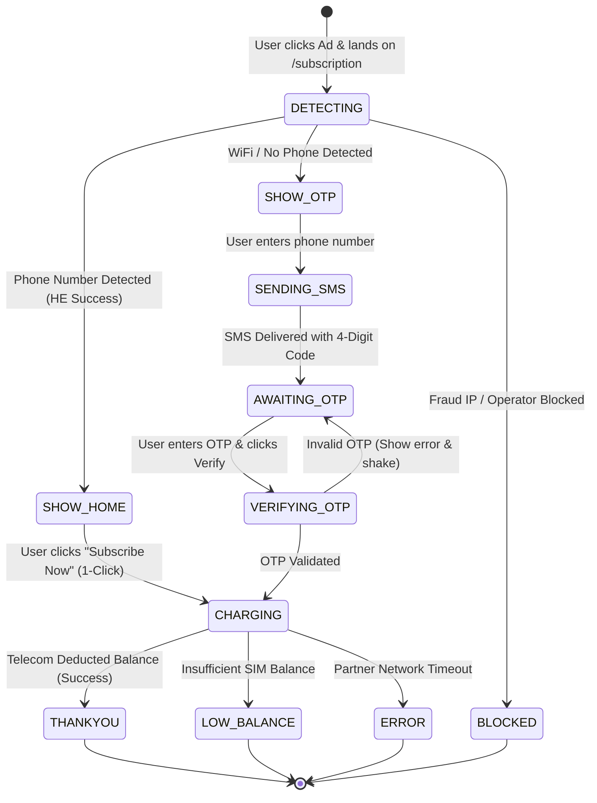

# Frontend Specification & Interactive Figma Prototype Prompt

> **Document Type:** Frontend Architecture & Master UI/UX Prototype Specification  
> **Tech Stack:** React 19, Vite, Tailwind CSS, Zustand, GrapesJS (Canvas Builder)  
> **Key Feature:** Complete "Playable" Design System & Step-by-Step Interactive Prototype Spec (Figma Play Button Format).

---

## 1. Frontend Architecture: Two Separate Experiences

Frontend application do bilkul alag worlds ko handle karta hai:

```
frontend/
├── Admin Portal (Private / Protected)        # Internal Team ke liye
│   ├── Markets & Operators Management
│   ├── Campaign Configuration & Flow Mode
│   ├── GrapesJS Visual Drag-and-Drop Editor
│   └── Real-time Analytics & Logs Dashboard
│
└── Public Funnel Runtime (/subscription)     # Real Mobile Users ke liye (Traffic)
    ├── Ultra-lightweight Mobile Container (< 50KB core)
    ├── Header Enrichment (HE) Auto-Detector
    ├── Dynamic Template Renderer (HTML/CSS)
    └── 1-Click Subscribe & OTP Verification Flow
```

---

## 2. Public Funnel Runtime: Clean State Machine

Public subscription page (`/subscription`) par koi confusion na ho, isliye yeh ek **Strict Finite State Machine** follow karta hai:



---

## 3. MASTER PROMPT: Interactive Figma-Style Design Spec (Working Play Prototype)

> 💡 **KAISE USE KAREIN:** Is section me diya gaya prompt aap directly kisi bhi UI Designer, AI Design tool (jaise Galileo, v0, Bolt, Figma AI) ya Frontend Developer ko de sakte hain. Yeh poore project ke flow ko aise explain karta hai jaise hum Figma me **"Play"** button click karke prototype dekh rahe hon!

```markdown
### =========================================================================
### [MASTER DESIGN PROMPT]: MOBILE CARRIER BILLING SUBSCRIPTION FUNNEL
### =========================================================================

Target Device: Mobile Viewport (375px x 812px - iPhone / Android Modern Aspect Ratio)
Visual Style: Premium Dark / Gaming / Fitness Theme (Deep Charcoal #0F172A background, Electric Emerald #10B981 for CTA actions, Neon Cyan #06B6D4 accents, Crisp White typography).
Typography: Modern Sans-Serif (Inter or Poppins).
Component Library: Tailwind CSS with smooth micro-interactions (framer-motion).

-----------------------------------------------------------------------------
### INTERACTIVE FLOW: STEP-BY-STEP "PLAY PROTOTYPE" MAPPING
-----------------------------------------------------------------------------

#### SCREEN 1: THE SMART DETECTOR (Loading & Identity Resolve)
* Trigger / Entry: User clicks an ad banner from Facebook/TikTok/Adsterra.
* URL: /subscription?country=AE&operator=Etisalat&campid=AE-ETISALAT-101&click_id=aff123
* Visuals:
  - Background: Subtle dark gradient with an animated radial pulse.
  - Center: Brand Logo ("GamerzHub Premium") with a sleek circular neon spinner.
  - Text below spinner: "Connecting securely to your mobile network..." (Font size: 14px, Color: Slate-400).
  - Bottom: Tiny telecom badge: "Powered by Etisalat UAE" with an SSL padlock icon.
* Transition (What happens after 600ms):
  - [Decision A - HE Success]: Screen seamlessly fades out -> Crossfades to SCREEN 2 (HOME - 1-Click).
  - [Decision B - WiFi / No HE]: Screen fades out -> Crossfades to SCREEN 3A (PHONE INPUT).

-----------------------------------------------------------------------------
#### SCREEN 2: THE HOME OFFER PAGE (1-Click HE Flow)
* User State: Mobile number already resolved in background (e.g., +971 50 *** 4589).
* Header:
  - Top Bar: Mini Operator Logo ("Etisalat") on left, Language switcher (EN / AR) on right.
* Hero Section:
  - Vibrant 3D Gaming Banner / Illustration with subtle floating animation.
  - Headline: "UNLIMITED GAMING VAULT" (Bold 24px, White).
  - Subhead: "Instant access to 500+ premium mobile games. No downloads needed." (14px, Slate-300).
* Value Badges:
  - 3 clean pill badges with check icons: [✓ Ad-Free] [✓ 4K Cloud Streaming] [✓ Cancel Anytime].
* Pricing & Identity Card:
  - Dark glassmorphism card (rgba(255,255,255,0.05) with 1px border #334155).
  - Row 1: "Subscribing with SIM:" -> "+971 50 *** 4589" (Bold Cyan #06B6D4).
  - Row 2: "Price:" -> "3.50 AED / Day (Auto-renewed from mobile balance)".
* Primary Action (CTA Button):
  - Big high-contrast Button (Height 56px, Rounded 16px, Gradient Emerald-500 to Emerald-600).
  - Button Text: "SUBSCRIBE NOW & PLAY" with a right-arrow icon.
  - Hover / Active: Subtle scale(0.98) press effect + glowing shadow.
* Compliance & Terms Footer:
  - Small print (10px, Slate-400): "By clicking Subscribe Now, you agree to recurring daily billing on your Etisalat mobile account. To unsubscribe, send STOP to 1111."
* INTERACTION (User Clicks "SUBSCRIBE NOW"):
  - Button state turns to "Processing..." with an inline white spinner.
  - Crossfades smoothly to SCREEN 4 (BILLING EXECUTION).

-----------------------------------------------------------------------------
#### SCREEN 3A: PHONE NUMBER INPUT (WiFi Fallback Flow)
* User State: User is on WiFi, so automatic number detection was not possible.
* Visuals:
  - Top Hero & Pricing remain identical to Screen 2.
  - Callout banner: "Enter your mobile number to receive your instant access pass."
  - Input Group:
    - Country Flag Icon + Country Prefix (+971) locked in a neat left-addon box.
    - Clean numeric input field with placeholder: "50 123 4567". Auto-focuses on load.
  - CTA Button: "SEND VERIFICATION CODE" (Electric Blue / Emerald).
* INTERACTION (User Enters Number & Clicks "SEND CODE"):
  - Button disables, displays "Sending SMS...".
  - Telecom SMS Gateway fires real 4-digit PIN.
  - Slides horizontally (Slide Left transition) to SCREEN 3B (OTP ENTRY).

-----------------------------------------------------------------------------
#### SCREEN 3B: OTP VERIFICATION MODAL / SCREEN
* Visuals:
  - Heading: "Verify Your Mobile" (20px Bold White).
  - Subtitle: "We sent a 4-digit code via SMS to +971 50 123 4567. [Change Number]".
  - OTP Pin Inputs: 4 individual rounded input boxes (50px x 60px each) with large numbers.
    - As user types each digit, auto-jumps to the next box.
    - Active box has a glowing emerald border.
  - Resend Timer: "Didn't receive SMS? Resend in 00:29" (countdown timer).
  - CTA Button: "CONFIRM & SUBSCRIBE" (Full width, Height 54px).
* INTERACTION:
  - If user enters wrong OTP: Input boxes shake with red border (CSS animation) + toast error: "Invalid code. Please check your SMS and try again."
  - If user enters correct OTP: Success sound/haptic -> Crossfades to SCREEN 4 (BILLING EXECUTION).

-----------------------------------------------------------------------------
#### SCREEN 4: BILLING & CHARGING EXECUTION (Micro-State)
* Visuals:
  - Center animated illustration: A sleek card/coin merging into a smartphone shield.
  - Status text: "Confirming subscription with your mobile carrier..."
  - Duration: 1.2 seconds max (or until backend webhook/response arrives).
* Result Routing:
  - If Partner responds Success -> Plays confetti particle animation -> Crossfades to SCREEN 5.
  - If Partner responds Low Balance -> Crossfades to SCREEN 6.
  - If Partner responds Blocked/Error -> Crossfades to SCREEN 7.

-----------------------------------------------------------------------------
#### SCREEN 5: THANK YOU / SUCCESS SCREEN (Access Unlocked!)
* Visuals:
  - Celebration: Green glowing checkmark circle with popping confetti effect.
  - Heading: "WELCOME TO GAMERZ HUB!" (Bold 24px, Emerald-400).
  - Subhead: "Your subscription is active! 3.50 AED has been billed to your mobile balance."
  - Subscription Receipt Card:
    - Transaction ID: #TXN-984128
    - Operator: Etisalat UAE
    - Renewal Date: Tomorrow, 10:00 AM
    - Unsubscribe info: SMS 'STOP' to 1111
  - Primary Action Button:
    - Glowing Purple/Indigo CTA: "START PLAYING NOW 🎮"
    - On Click: Opens the actual games portal / content URL.
* Background Action:
  - Silent S2S Postback fires to ad network (Conversion successfully recorded).

-----------------------------------------------------------------------------
#### SCREEN 6: LOW BALANCE / INSUFFICIENT FUNDS
* Visuals:
  - Warning Icon: Amber/Yellow wallet with exclamation badge.
  - Heading: "Insufficient Mobile Balance" (20px, Amber-300).
  - Description: "Your operator was unable to charge 3.50 AED. Please recharge your mobile balance and try again."
  - Actions:
    - Primary Button: "RETRY SUBSCRIPTION" (Re-initiates charge attempt).
    - Secondary Link: "Change Mobile Number".

-----------------------------------------------------------------------------
#### SCREEN 7: BLOCKED / NOT AVAILABLE
* Visuals:
  - Error Icon: Shield with cross or lock icon.
  - Heading: "Service Unavailable" (20px, Slate-200).
  - Description: "This offer is not available for your mobile operator or region."
  - Action Button: "Return to Homepage" or Close.
```

---

## 4. State Management with Zustand (Super Modular)

Code ko clean aur short rakhne ke liye frontend state ko 3 chhote stores me baanta gaya hai:

1. **`useAuthStore.js` (< 60 lines):**
   - Admin token, user profile, login/logout handlers.
2. **`useCampaignStore.js` (< 90 lines):**
   - Admin campaign list, active editing campaign, verification mode (`BOTH` / `OTP_ONLY`).
3. **`useFunnelStore.js` (< 110 lines):**
   - Public runtime session data: `visitId`, `phone`, `currentStep`, `loading`, `error`, `selectedPack`.

Har component sirf apne matlab ka data subscribe karta hai, jisse koi unwanted re-render nahi hota aur speed super-fast rehti hai.
