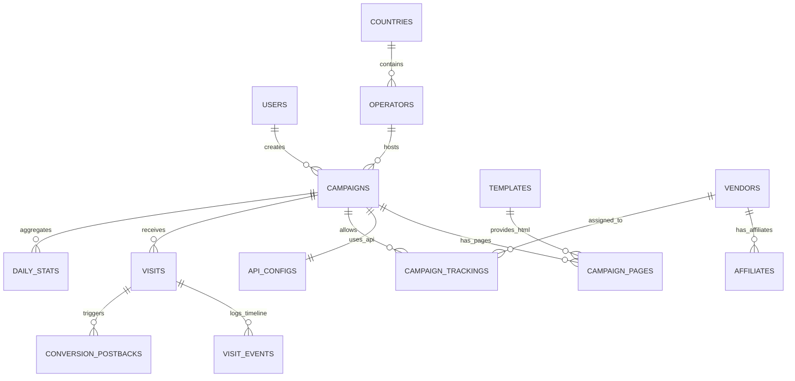

# Database Schema: Tables, Relationships & Performance Indexes

> **Document Type:** Database Design & Data Architecture Blueprint  
> **Supported Databases:** PostgreSQL 15+ / MySQL 8.0+  
> **ORM:** TypeORM / Prisma Schema Compatible  
> **Key Goal:** 100% Normalized, Clean, Zero Legacy Dead Weight, High-Throughput Indexes.

---

## 1. Database Entity-Relationship (ER) Diagram



---

## 2. Table-by-Table Deep Dive (Non-Tech Explanation)

| # | Table Name | Purpose (Simple Hindi-English) | High-Traffic? |
| :- | :--- | :--- | :-: |
| 1 | **`users`** | Admin aur Campaign managers ka login data (Email, Password hash, Role). | Low |
| 2 | **`countries`** | Target countries (e.g. UAE, South Sudan, Kenya, Saudi Arabia). | Low |
| 3 | **`operators`** | Har country ke telecom operators (e.g. Etisalat, du, Zain, Safaricom). | Low |
| 4 | **`campaigns`** | Hamare offers/products (e.g. "Gamerz Hub UAE", billing price, mode). | Low |
| 5 | **`templates`** | GrapesJS se banaye gaye page HTML, CSS aur builder project data. | Low |
| 6 | **`campaign_pages`** | Kis campaign me kaunsa page type (`HOME`, `OTP`, `CONFIRM`, etc.) kaunsa template use karega. | Low |
| 7 | **`api_configs`** | Telecom partner ke billing aur OTP URLs (TickHighs, SubOTP, etc.). | Low |
| 8 | **`vendors`** | Ad Networks jo hume traffic bhejte hain (e.g. PropellerAds, Mobidea). | Low |
| 9 | **`affiliates`** | Vendors ke andar ke individual affiliate publishers. | Low |
| 10 | **`campaign_trackings`** | Rules: Kaunsa vendor kis campaign ko promote kar sakta hai aur kitna payout milega. | Low |
| 11 | **`visits`** | **[CORE TRAFFIC TABLE]** Har user click ka complete record (IP, Phone, Status). | 🔥 VERY HIGH |
| 12 | **`visit_events`** | User ne page par kya-kya action liya (Loaded -> Clicked -> OTP Sent). | 🔥 VERY HIGH |
| 13 | **`conversion_postbacks`** | Ad network ko bheje gaye postback alerts ka audit log. | High |
| 14 | **`api_call_logs`** | Telecom operator ke sath hue har HTTP call ka response time aur status. | High |
| 15 | **`daily_stats`** | Daily aggregated summary (Clicks, Subscribers, Revenue) for fast dashboard. | Low |

---

## 3. Schema DDL & Column Specifications

### 3.1 Core Admin & Configuration Tables

#### Table: `users`
```sql
CREATE TABLE users (
    id SERIAL PRIMARY KEY,
    name VARCHAR(100) NOT NULL,
    email VARCHAR(150) UNIQUE NOT NULL,
    password_hash VARCHAR(255) NOT NULL,
    role VARCHAR(30) DEFAULT 'admin', -- 'superadmin', 'manager', 'viewer'
    is_active BOOLEAN DEFAULT TRUE,
    created_at TIMESTAMP DEFAULT CURRENT_TIMESTAMP,
    updated_at TIMESTAMP DEFAULT CURRENT_TIMESTAMP
);
```

#### Table: `countries` & `operators`
```sql
CREATE TABLE countries (
    id SERIAL PRIMARY KEY,
    name VARCHAR(100) NOT NULL,
    code VARCHAR(10) UNIQUE NOT NULL, -- e.g. 'AE', 'KE', 'SS'
    dial_code VARCHAR(10) NOT NULL,   -- e.g. '+971', '+254'
    currency VARCHAR(10) NOT NULL,    -- e.g. 'AED', 'KES'
    is_active BOOLEAN DEFAULT TRUE,
    created_at TIMESTAMP DEFAULT CURRENT_TIMESTAMP
);

CREATE TABLE operators (
    id SERIAL PRIMARY KEY,
    country_id INT REFERENCES countries(id) ON DELETE CASCADE,
    name VARCHAR(100) NOT NULL,        -- e.g. 'Etisalat', 'Zain'
    code VARCHAR(50) NOT NULL,         -- e.g. 'ETISALAT', 'ZAIN'
    detection_headers JSONB DEFAULT '[]', -- Headers to look for HE
    is_active BOOLEAN DEFAULT TRUE,
    created_at TIMESTAMP DEFAULT CURRENT_TIMESTAMP,
    UNIQUE(country_id, code)
);
```

#### Table: `campaigns`
```sql
CREATE TABLE campaigns (
    id SERIAL PRIMARY KEY,
    name VARCHAR(150) NOT NULL,
    tracking_id VARCHAR(50) UNIQUE NOT NULL, -- e.g. 'AE-ETISALAT-101'
    operator_id INT REFERENCES operators(id) ON DELETE RESTRICT,
    country_code VARCHAR(10) NOT NULL,
    operator_code VARCHAR(50) NOT NULL,
    verification_mode VARCHAR(30) NOT NULL DEFAULT 'BOTH', -- 'BOTH', 'OTP_ONLY', 'HEADER_INJECTION', 'NONE'
    service_id VARCHAR(100),                 -- Partner Service ID
    price_text VARCHAR(50) DEFAULT '3.5 AED/day',
    is_active BOOLEAN DEFAULT TRUE,
    daily_cap INT DEFAULT 0,                 -- 0 = Unlimited conversions
    created_at TIMESTAMP DEFAULT CURRENT_TIMESTAMP,
    updated_at TIMESTAMP DEFAULT CURRENT_TIMESTAMP
);
```

#### Table: `templates` & `campaign_pages`
```sql
CREATE TABLE templates (
    id SERIAL PRIMARY KEY,
    name VARCHAR(150) NOT NULL,
    html_content TEXT NOT NULL,
    css_content TEXT DEFAULT '',
    project_data JSONB DEFAULT '{}',          -- GrapesJS canvas internal JSON
    created_at TIMESTAMP DEFAULT CURRENT_TIMESTAMP,
    updated_at TIMESTAMP DEFAULT CURRENT_TIMESTAMP
);

CREATE TABLE campaign_pages (
    id SERIAL PRIMARY KEY,
    campaign_id INT REFERENCES campaigns(id) ON DELETE CASCADE,
    page_type VARCHAR(30) NOT NULL,          -- 'HOME', 'OTP', 'CONFIRM', 'THANKYOU', 'BLOCKED', 'ERROR', 'LOW_BALANCE'
    template_id INT REFERENCES templates(id) ON DELETE SET NULL,
    is_active BOOLEAN DEFAULT TRUE,
    created_at TIMESTAMP DEFAULT CURRENT_TIMESTAMP,
    UNIQUE(campaign_id, page_type)
);
```

#### Table: `api_configs` (Partner Billing URLs)
```sql
CREATE TABLE api_configs (
    id SERIAL PRIMARY KEY,
    campaign_id INT UNIQUE REFERENCES campaigns(id) ON DELETE CASCADE,
    check_sub_url TEXT,                      -- Partner status check API
    send_otp_url TEXT,                       -- Partner OTP trigger API
    verify_otp_url TEXT,                     -- Partner OTP validate API
    subscribe_url TEXT,                      -- Direct charge API (for HE 1-click)
    blocklist_url TEXT,                      -- DND / Blacklist check API
    resolve_msisdn_url TEXT,                 -- Remote HE resolution API
    created_at TIMESTAMP DEFAULT CURRENT_TIMESTAMP,
    updated_at TIMESTAMP DEFAULT CURRENT_TIMESTAMP
);
```

---

### 3.2 Traffic Partners & Tracking

#### Table: `vendors` & `affiliates`
```sql
CREATE TABLE vendors (
    id SERIAL PRIMARY KEY,
    name VARCHAR(100) NOT NULL,              -- e.g. 'PropellerAds', 'Mobidea'
    code VARCHAR(50) UNIQUE NOT NULL,        -- e.g. 'ADM01', 'PROPELLER'
    postback_url TEXT,                       -- e.g. 'https://track.com/postback?clickid={click_id}&payout={payout}'
    is_active BOOLEAN DEFAULT TRUE,
    created_at TIMESTAMP DEFAULT CURRENT_TIMESTAMP
);

CREATE TABLE affiliates (
    id SERIAL PRIMARY KEY,
    vendor_id INT REFERENCES vendors(id) ON DELETE CASCADE,
    name VARCHAR(100) NOT NULL,
    affiliate_code VARCHAR(50) NOT NULL,     -- e.g. 'AFF_BE'
    is_active BOOLEAN DEFAULT TRUE,
    created_at TIMESTAMP DEFAULT CURRENT_TIMESTAMP,
    UNIQUE(vendor_id, affiliate_code)
);

CREATE TABLE campaign_trackings (
    id SERIAL PRIMARY KEY,
    campaign_id INT REFERENCES campaigns(id) ON DELETE CASCADE,
    vendor_id INT REFERENCES vendors(id) ON DELETE CASCADE,
    affiliate_id INT REFERENCES affiliates(id) ON DELETE SET NULL,
    payout_usd NUMERIC(10, 4) DEFAULT 1.5000,
    daily_cap INT DEFAULT 0,
    is_active BOOLEAN DEFAULT TRUE,
    created_at TIMESTAMP DEFAULT CURRENT_TIMESTAMP,
    UNIQUE(campaign_id, vendor_id, affiliate_id)
);
```

---

### 3.3 High-Throughput Runtime & Analytics Tables

#### Table: `visits` (Har Incoming Ad Click)
```sql
CREATE TABLE visits (
    id VARCHAR(64) PRIMARY KEY,              -- e.g. 'vst_1723456789_abc123'
    campaign_id INT REFERENCES campaigns(id) ON DELETE RESTRICT,
    vendor_id INT REFERENCES vendors(id) ON DELETE SET NULL,
    affiliate_id INT REFERENCES affiliates(id) ON DELETE SET NULL,
    tracking_campid VARCHAR(50) NOT NULL,
    click_id VARCHAR(255),                   -- Ad network identifier
    msisdn VARCHAR(30),                      -- User phone number (if resolved)
    user_ip VARCHAR(50),
    user_agent TEXT,
    he_resolved BOOLEAN DEFAULT FALSE,       -- Kya phone HE se mila?
    otp_verified_at TIMESTAMP,               -- OTP verification timestamp
    status VARCHAR(30) NOT NULL DEFAULT 'VISIT', -- 'VISIT', 'HOME_SHOWN', 'OTP_SHOWN', 'SUBSCRIBED', 'BLOCKED', 'FAILED'
    created_at TIMESTAMP DEFAULT CURRENT_TIMESTAMP,
    updated_at TIMESTAMP DEFAULT CURRENT_TIMESTAMP
);

-- Critical Performance Indexes (for millions of clicks)
CREATE INDEX idx_visits_campaign_created ON visits(campaign_id, created_at DESC);
CREATE INDEX idx_visits_click_id ON visits(click_id);
CREATE INDEX idx_visits_status ON visits(status);
```

#### Table: `visit_events` (Granular User Step Timeline)
```sql
CREATE TABLE visit_events (
    id BIGSERIAL PRIMARY KEY,
    visit_id VARCHAR(64) REFERENCES visits(id) ON DELETE CASCADE,
    event_type VARCHAR(50) NOT NULL,         -- 'DETECT_SUCCESS', 'PAGE_VIEW', 'OTP_SENT', 'OTP_VERIFY_SUCCESS', 'SUBSCRIBE_SUCCESS'
    page_type VARCHAR(30),                   -- 'HOME', 'OTP', 'CONFIRM', 'THANKYOU'
    metadata JSONB DEFAULT '{}',
    created_at TIMESTAMP DEFAULT CURRENT_TIMESTAMP
);

CREATE INDEX idx_visit_events_visit_id ON visit_events(visit_id);
```

#### Table: `conversion_postbacks` (S2S Ad Network Logs)
```sql
CREATE TABLE conversion_postbacks (
    id SERIAL PRIMARY KEY,
    visit_id VARCHAR(64) REFERENCES visits(id) ON DELETE CASCADE,
    vendor_id INT REFERENCES vendors(id) ON DELETE SET NULL,
    click_id VARCHAR(255) NOT NULL,
    request_url TEXT NOT NULL,
    http_status INT,
    response_body TEXT,
    is_success BOOLEAN DEFAULT FALSE,
    attempts INT DEFAULT 1,
    created_at TIMESTAMP DEFAULT CURRENT_TIMESTAMP
);

CREATE INDEX idx_postbacks_click_id ON conversion_postbacks(click_id);
```

#### Table: `daily_stats` (Pre-Aggregated Fast Analytics)
```sql
CREATE TABLE daily_stats (
    id SERIAL PRIMARY KEY,
    stat_date DATE NOT NULL,
    campaign_id INT REFERENCES campaigns(id) ON DELETE CASCADE,
    vendor_id INT REFERENCES vendors(id) ON DELETE CASCADE,
    total_visits INT DEFAULT 0,
    he_hits INT DEFAULT 0,
    otp_sent INT DEFAULT 0,
    otp_verified INT DEFAULT 0,
    total_conversions INT DEFAULT 0,
    revenue_usd NUMERIC(12, 4) DEFAULT 0.0000,
    UNIQUE(stat_date, campaign_id, vendor_id)
);

CREATE INDEX idx_daily_stats_date ON daily_stats(stat_date DESC);
```

---

## 4. Purani Schema Se Kya Hataya Gaya Hai? (Dead Code Cleanup)

| Item | Status | Kyun Hataya? |
| :--- | :--- | :--- |
| `otp_requests` table | **REMOVED** | Telecom partner khud OTP generate karta hai aur verify karta hai. Hume locally OTP code save karne ki zaroorat nahi hoti. Isse DB size bachta hai aur security badhti hai. |
| `api_configs.user_api` | **REMOVED** | Yeh field purane code me kabhi read ya write nahi hoti thi. |
| `api_configs.otp_provider` | **REMOVED** | Hamesha `partner` hi hota tha, redundant thi. |
| Legacy page types (`LANDING`, `OTP_PROMPT`, `SUCCESS`) | **REMOVED** | Ab sirf standardized 6 types hain: `HOME`, `OTP`, `CONFIRM`, `THANKYOU`, `BLOCKED`, `ERROR`, `LOW_BALANCE`. |
| Twilio / MSG91 / Kaleyra code | **REMOVED** | Real telecom carrier billing me local SMS aggregators use nahi hote, direct telecom partner APIs use hoti hain. |
