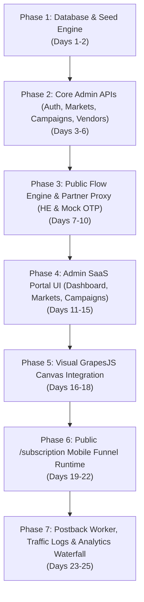

# Step-by-Step Scratch Build Roadmap & Clean Code Checklist

> **Document Type:** End-to-End Execution Roadmap & Quality Assurance Checklist  
> **Platform Scope:** Entire WAP Manager Enterprise SaaS Platform  
> **Estimated Execution Time:** 3 to 4 Weeks (Structured Sprints)  
> **Key Focus:** Zero-Stress execution, Clean milestones, Test-driven verification.

---

## 1. Overview of Build Phases

---

## 2. Phase-by-Phase Execution Guide

### Phase 1: Database Setup & Seed Engine (Days 1 - 2)
*Goal: Database tables ready hon aur ek standard demo seed script run ho sake.*
- [ ] PostgreSQL / MySQL database spin up karo.
- [ ] [05-DATABASE-SCHEMA.md](file:///d:/dddd/rebuild-blueprint/05-DATABASE-SCHEMA.md) ke hisab se TypeORM ya Prisma migrations likho (all 15 tables).
- [ ] High-throughput indexes create karo (`visits(campaign_id, created_at)`, `visits(click_id)`).
- [ ] Clean `seed.js` script banao jo demo data insert kare:
  - 1 Superadmin user (`admin@domain.com` / `admin123`).
  - 1 Country (`UAE`, code: `AE`).
  - 1 Operator (`Etisalat`, code: `ETISALAT`, detection headers configured).
  - 1 Campaign (`AE-ETISALAT-101`, Mode: `BOTH`).
  - 1 Vendor (`PropellerAds`, code: `ADM01`) with dummy postback URL.
  - 6 Default Templates (`HOME`, `OTP`, `CONFIRM`, `THANKYOU`, `BLOCKED`, `ERROR`, `LOW_BALANCE`).
*Verification Test:* `npm run db:seed` run karne par bina kisi error ke database ready ho jaye.

---

### Phase 2: Backend Core Admin APIs (Days 3 - 6)
*Goal: Admin panel ke saare data management APIs ready hon.*
- [ ] **`modules/auth`**: JWT Login & `/me` endpoint (< 100 lines).
- [ ] **`modules/markets`**: Country & Operator create, list, toggle active, detection header configuration.
- [ ] **`modules/partners`**: Vendor create, affiliate create, postback URL template configuration.
- [ ] **`modules/campaigns`**: Campaign create with tracking ID generation (`{CC}-{OP}-{ID}`), verification mode switcher (`BOTH`, `OTP_ONLY`, `HEADER_INJECTION`).
- [ ] **`modules/templates`**: GrapesJS ProjectData JSON, HTML, and CSS save & fetch endpoints.
*Verification Test:* Postman / Thunder Client se login karke naya campaign create karke dekho.

---

### Phase 3: Runtime Flow Engine & Partner Proxy (Days 7 - 10)
*Goal: Public user flow backend aur telecom partner APIs ready hon.*
- [ ] **`modules/flow/helpers/he-resolver.js`**: Incoming HTTP headers se MSISDN detect karne ka clean helper (< 80 lines).
- [ ] **`modules/flow/flow.service.js`**:
  - `GET /api/flow/detect-msisdn`: Visit create kare aur HE check kare.
  - `GET /api/flow/page`: Requested pageType ka HTML/CSS dynamic placeholders (`{{msisdn}}`, `{{price}}`) replace karke return kare.
  - `POST /api/flow/transition`: State transition logic handle kare.
- [ ] **`modules/otp/otp.service.js`**: Telecom partner OTP send aur verify API wrapper.
- [ ] **Local Mock Provider**: `MOCK_PARTNER_OTP=true` hone par bina real SMS ke `1234` OTP verify kare for fast local testing.
*Verification Test:* `curl` se `/api/flow/detect-msisdn` call karke dekho, naya `visit_id` generate hona chahiye.

---

### Phase 4: Frontend Admin SaaS Dashboard (Days 11 - 15)
*Goal: Clean, modern desktop web UI for the full WAP Manager business.*
- [ ] React 19 + Vite + Tailwind CSS + Lucide Icons setup.
- [ ] Zustand stores setup (`useAuthStore.js`, `useMarketStore.js`, `useCampaignStore.js`, `useAnalyticsStore.js`).
- [ ] Pages:
  - `LoginPage.jsx`: Email & password login.
  - `DashboardPage.jsx`: Live executive KPIs (Visits, HE%, Conversions, CR%, Revenue) with hourly sparklines.
  - `MarketsPage.jsx`: Countries & Operators table with add modals and detection header inspector.
  - `CampaignsPage.jsx`: All campaigns list with status toggles.
  - `CampaignDetailPage.jsx`:
    - Verification mode selector (`BOTH`, `OTP_ONLY`, `HEADER_INJECTION`).
    - Assigned partner API config URLs modal.
    - Vendor assignment modal with custom payout ($) and daily caps.
    - Funnel pages visual manager (6 page cards with thumbnails).
    - Attribution tracking URL generator with 1-click copy.
*Verification Test:* Admin UI se naya campaign banao, mode set karo, aur uska tracking URL copy karo.

---

### Phase 5: GrapesJS Visual Canvas Integration (Days 16 - 18)
*Goal: Admin visual drag-and-drop karke landing page design kar sake.*
- [ ] GrapesJS core & preset web-page integrate karo `VisualEditorPage.jsx` me.
- [ ] Custom Blocks Drawer: Hero sections, subscribe buttons, phone input groups, OTP PIN boxes, pricing cards.
- [ ] **Custom Property Panel**: Button component par custom attribute dropdowns:
  - "When Clicked" -> `[SUBSCRIBE Flow, Go to Page, External URL]`.
- [ ] Multi-viewport switcher (Desktop, Mobile 375px, Tablet).
- [ ] Save button jo template ka raw HTML, CSS aur GrapesJS JSON database me save kare.
*Verification Test:* Editor me ek naya button daal kar action "SUBSCRIBE Flow" set karo aur save karke preview check karo.

---

### Phase 6: Public `/subscription` Runtime Page (Days 19 - 22)
*Goal: End-user mobile landing page jo ultra-fast load ho aur high conversion rate de.*
- [ ] Mobile-optimized frame design follow karo: [04-FRONTEND-SPECIFICATION.md](file:///d:/dddd/rebuild-blueprint/04-FRONTEND-SPECIFICATION.md).
- [ ] Modular React hooks banao:
  - `useDetect.js`: Detect API call kare aur state decide kare.
  - `useOtpFlow.js`: Timer, 4-digit input box, aur OTP verify API call.
  - `usePageRenderer.js`: Dynamic HTML ko safe shadow container me inject kare.
- [ ] Micro-interactions & animations (Framer Motion):
  - Wrong OTP par input shake animation.
  - Success par Confetti celebration.
*Verification Test:* Mobile browser me link open karke mock OTP `1234` daal kar Thank You page tak flow verify karo.

---

### Phase 7: Postbacks, Traffic Logs & Analytics Waterfall (Days 23 - 25)
*Goal: Real-time reporting, session waterfall, aur ad networks ko conversion notifications.*
- [ ] **`modules/postbacks`**: Subscribe success hote hi async worker vendor ke postback URL ko HTTP GET call kare aur retry queue maintain kare.
- [ ] **`SessionDetailPage.jsx`**: Har visit ka deep waterfall timeline (User visit -> HE detect -> CTA click -> Partner API response -> Postback delivery).
- [ ] **`PostbacksPage.jsx`**: Postback delivery status table with manual retry button for failed alerts.
- [ ] **`CacheManagementPage.jsx`**: Redis flush button to clear template cache instantly.
*Verification Test:* Dummy vendor URL setup karke dekho ki conversion par postback hit ho raha hai aur Session Inspector me timeline clean dikh rahi hai.

---

## 3. Clean Code & "Anti-Mess" Review Checklist

Code commit ya merge karne se pehle har developer ko yeh 5 sawal khud se puchne hain:

| # | Check | Rule | Pass/Fail |
| :- | :--- | :--- | :-: |
| 1 | **File Length Check** | Kya is file me **200 lines se kam** code hai? | [ ] |
| 2 | **Single Responsibility** | Kya controller sirf req/res handle kar raha hai aur saara business logic service me hai? | [ ] |
| 3 | **No God Hooks** | Kya React component me lambe `useEffect` ya 10 se zyada `useState` hain? (Agar haan, toh custom hook me split karo). | [ ] |
| 4 | **Self-Explaining Names** | Kya variable names crystal clear hain? (No `res1`, `p`, `chk`, `tmp`). | [ ] |
| 5 | **Error Handling** | Kya har external telecom API call par `try-catch` aur `timeout` laga hua hai? | [ ] |

Agar in 5 sawalon ka jawab "YES" hai, toh code hamesha clean, understandable aur maintainable rahega!
