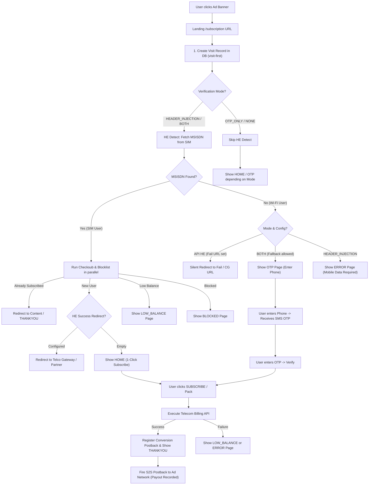

# 01 - Master Architecture & Conceptual Flow
## Telecom WAP Carrier Billing & Subscription Funnel Manager

> **Purpose:** Ye document WAP Manager platform ke poore high-level architecture, mental model, aur core workflows ko simple aur detailed Hinglish me explain karta hai taaki aap kisi bhi client, team member ya stakeholder ko confident hoke samjha sakein.

---

### 1. WAP Manager Kya Hai? (Core Product Purpose)

Jab koi mobile user internet browse karte waqt kisi ad banner (Facebook, TikTok, Google Ads, Adsterra) par click karta hai, toh telecom companies (jaise Etisalat, Zain, Safaricom, Orange, Airtel) user ke mobile balance (prepaid ya postpaid) se direct subscription charge kar sakti hain. Is process ko **DCB (Direct Carrier Billing)** ya **WAP Billing** kehte hain.

Is platform ka main kaam ye hai:
1. **Traffic Capture & Attribution:** Ad network ke click ko capture karna bina kisi attribution loss ke.
2. **Network & Identity Detection (HE):** Pata lagana ki user mobile data (SIM) par hai ya Wi-Fi par, aur SIM ka mobile number (MSISDN) silently read karna.
3. **Smart Decision Routing:** User ka status check karna (Active hai? Blocklist me hai? Low balance hai?) aur usi hisab se sahi page ya external URL par bhejna.
4. **Interactive Funnel Execution:** Mobile-optimized landing pages show karna (1-Click HE, OTP verification, Pack selection, ya direct billing).
5. **Telecom Billing & S2S Postbacks:** Telecom gateway par charge request bhejna aur conversion successful hote hi advertising network ko S2S Postback fire karna.

```
[Ad Network Click (TikTok / FB)]
             │
             ▼
  /subscription?country=AE&operator=Etisalat&campid=AE-ETISALAT-101&click_id=aff123
             │
             ▼
   ┌─────────────────────────────────────────────────────────────┐
   │             WAP MANAGER PUBLIC FUNNEL ENGINE                │
   │                                                             │
   │  1. Visit Created First (visitId, internal clickId generated) │
   │  2. Carrier Header Enrichment (HE) Check (SIM vs Wi-Fi)     │
   │  3. Partner APIs Check (Checksub + Blocklist in parallel)   │
   │  4. Smart Decision Matrix (8 Outbound Paths)               │
   └─────────────────────────────────────────────────────────────┘
             │
   ┌─────────┴───────────────────────┬───────────────────────────┐
   ▼                                 ▼                           ▼
[External Redirect]          [Internal Status Pages]     [Interactive Funnel]
• HE Success URL              • THANKYOU (Already Subbed) • HOME (1-Click HE)
• HE Fail URL (Wi-Fi)         • INPROGRESS (Pending)      • OTP (Mobile + PIN)
• Carrier Gateway (CG) URL    • LOW_BALANCE (Parking)     • CONFIRM (Pack Selection)
                              • BLOCKED (DND / Fraud)     • DCB Pin & Verify
                              • ERROR (Billing Failed)
```

---

### 2. The 3 "What Happens Next?" Decision Layers (The "Kichdi" Resolved)

Purane systems me sabse badi confusion ye hoti thi ki landing page ka decision kaun leta hai, button click par kya hota hai, aur canvas ka switch kaise kaam karta hai. WAP Manager me ye teen alag-alag layers hain jo aapas me conflict nahi karti:

```
┌─────────────────────────────────────────────────────────────────────────────┐
│ LAYER A: LANDING & HE DETECT ROUTING (Backend-Heavy)                       │
│ Trigger: User landing page open karta hai (/api/flow/detect-msisdn)         │
│ Responsibility: Silently number detect karna, Checksub & Blocklist run      │
│ karna, aur decide karna ki user ko site se bahar redirect karna hai ya     │
│ kisi specific status page par bhejna hai.                                   │
└─────────────────────────────────────────────────────────────────────────────┘
                                      │
                                      ▼
┌─────────────────────────────────────────────────────────────────────────────┐
│ LAYER B: FLOW GRAPH & VERIFICATION MODE (Engine-Governed)                   │
│ Trigger: User kisi primary CTA button par click karta hai (data-action=     │
│ "SUBSCRIBE" ya "CONFIRM") -> POST /api/flow/transition                     │
│ Responsibility: Campaign ke verificationMode (BOTH, OTP_ONLY, DCB, etc.)   │
│ ke hisab se next funnel screen (HOME -> OTP -> CONFIRM) decide karna.       │
└─────────────────────────────────────────────────────────────────────────────┘
                                      │
                                      ▼
┌─────────────────────────────────────────────────────────────────────────────┐
│ LAYER C: CANVAS BUTTON HOTSPOTS & PRIORITY CHAIN (Frontend-Owned)          │
│ Trigger: Canvas me banaye gaye buttons jisme direct href="CONFIRM", pack    │
│ click (data-pack="daily"), ya multi-API check chain lagi ho.                │
│ Responsibility: Instant page switch ya client-side routing jo Layer B graph │
│ ko bypass karke direct action leti hai.                                     │
└─────────────────────────────────────────────────────────────────────────────┘
```

#### Layer Comparison Table:

| Layer | System | Kahan Configure Hota Hai? | Runtime Pe Kab Chalta Hai? | Source of Truth |
| :--- | :--- | :--- | :--- | :--- |
| **Layer A** | **Detect Routing** | Campaign API Configs (`api_configs`) & HE Settings | Jab user campaign link par land hota hai (`GET /detect-msisdn`) | External Redirects (HE Success/Fail/CG) ya Status Pages |
| **Layer B** | **Flow Graph (Mode)** | Campaign Detail Mode Picker (`verificationMode` + `funnel_layout`) | Jab user "Continue Signup" button click kare (`POST /transition`) | Screen Sequence (HOME -> OTP -> CONFIRM -> THANKYOU) |
| **Layer C** | **Canvas Hotspots** | GrapesJS Visual Editor Property Panel | Jab user canvas element / pack / hotspot click kare | Direct page jumps, pack select, priority chain |

---

### 3. Do Solid Non-Negotiable Invariants (Rules That Never Break)

WAP Manager ke architecture me do rules hamesha follow hote hain chahe koi bhi telecom provider ho:

#### Invariant 1: Visit-First Rule (Attribution Integrity)
> **Rule:** Jab bhi koi user campaign link open karega, system sabse pehle database me ek `visit` record banayega **Kisi bhi partner HTTP request (HE token, checksub, blocklist) se pehle.**
- Har visit ka ek internal `click_id` (UUID) generate hota hai.
- Incoming affiliate click ko `rcid` kehte hain aur use hamesha session me lock rakha jata hai.
- Redis lock aur 120-second dedupe window lagti hai taaki agar mobile browser double click kare ya back button dabaye toh do separate visits na banein.
- Iska fayda: Har ek telecom API call log (`api_call_logs`) usi single `visit_id` ke saath map rehti hai.

#### Invariant 2: Third-Party Hard Privacy Boundary
> **Rule:** Hamara internal tracking data (`click_id`, `rcid`, `tracking_campid`, `visitId`) kabhi bhi telecom partner ya third-party redirect URLs me query parameter ban kar auto-leak nahi hona chahiye.
- Jab user telecom operator ke gateway par redirect hota hai, toh URL me sirf allowed placeholders (jaise `{{msisdn}}`, `{{country}}`, `{{operator}}`) replace hote hain.
- Partner API ke payload me sirf phone, serviceId, country aur operator jata hai; internal database IDs leak nahi hoti.
- Exception: Jab subscription complete ho jaye aur hum advertising vendor ko S2S postback bhejte hain, tab `{{click_id}}` aur `{{rcid}}` expand hoti hai kyunki ad network ko wahi click id chahiye payout credit karne ke liye.

---

### 4. End-to-End User Journey (Bird's Eye View)



---

### 5. Summary For Stakeholders & Clients

Agar aapko kisi ko simple words me explain karna ho ki WAP Manager kya karta hai:
> *"WAP Manager ek high-performance mobile subscription engine hai jo ad networks aur mobile network operators (telcos) ke beech bridge ka kaam karta hai. Ye mobile users ko 1-click ya OTP ke zariye directly unke SIM balance se subscribe karwata hai, low balance aur blocklist check karta hai, aur conversions ko 100% accuracy ke saath track karke affiliates ko real-time postback bhejta hai."*
