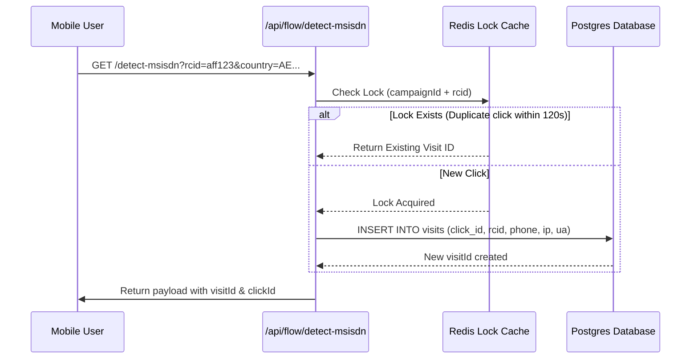

# 02 - Attribution, Visit Lifecycle & S2S Postbacks
## Accurate Tracking, Dual Campaign IDs & Conversion Flow

> **Purpose:** Ye document WAP Manager ke tracking system, click attribution (`rcid` vs `click_id`), dual campaign ID resolution, aur Server-to-Server (S2S) conversion postback ke poore lifecycle ko explain karta hai.

---

### 1. Dual Click ID Architecture: `rcid` vs `click_id`

Affiliate marketing aur performance campaigns me tracking loss se bachne ke liye do alag-alag click IDs use kiye jate hain. Dono ka role bilkul alag hai:

```
[Ad Network Click: TikTok / PropellerAds]
               │  URL parameter: click_id=aff_xyz_98765
               ▼
┌─────────────────────────────────────────────────────────────┐
│ 1. INCOMING ATTRIBUTION SEED:                               │
│    Ad network ka click id humare system me "rcid" banta hai │
│    (Remote Click ID / Affiliate Click ID).                  │
│                                                             │
│ 2. INTERNAL VISIT MINTING:                                  │
│    Humara system turant ek naya unique UUID generate karta   │
│    hai jise "click_id" (humara internal Click ID) kehte     │
│    hain.                                                    │
└─────────────────────────────────────────────────────────────┘
```

#### Comparison Table:

| Parameter | Owner | Example Value | Kahan Store Hota Hai? | Purpose |
| :--- | :--- | :--- | :--- | :--- |
| `rcid` | **Affiliate / Ad Network** | `aff_tiktok_987123` | `visits.rcid` aur browser `sessionStorage` | Conversion hone ke baad ad network ko batana ki kaunsa user convert hua. |
| `click_id` | **Humara Platform (WAP Manager)** | `550e8400-e29b-41d4-a716-446655440000` | `visits.click_id` aur har log table me | Database me har action, page transition, aur API log ko track karna. |

#### First-Land Attribution Rule:
1. Jab user landing page par aata hai:
   - Agar URL me `rcid` hai, toh wo `rcid` ban jata hai.
   - Agar URL me sirf `click_id` hai (aur ye nayi visit hai), toh system use affiliate seed maanta hai aur use `rcid` me store kar leta hai.
2. Uske baad system ek fresh internal `click_id` (UUID) mint karta hai.
3. Uske baad pure frontend aur API me humara internal `click_id` chalega, aur `rcid` chupchap session me store rahega jab tak postback fire na ho.

---

### 2. Dual Campaign IDs (`tracking_campid` vs `campid`)

Aksar ad networks apne tracking link me `campid` bhejte hain, jabki humara platform campaigns ko identify karne ke liye internal tracking IDs use karta hai. Isliye system me **Dual Campaign ID** resolution hota hai:

```
Link URL: /subscription?tracking_campid=AE-ETISALAT-101&campid=network_camp_55
                               │                               │
                               ▼                               ▼
                 [Humara Internal Identifier]     [Vendor / Network Identifier]
                  Resolves Campaign in DB          Fills Postback {{campid}}
```

1. **`tracking_campid` (Humara ID):**
   - Format: Composite string jaise `AE-ETISALAT-101` ya numeric campaign ID.
   - Ye database me country, operator aur campaign settings ko resolve karta hai.
2. **`campid` (Vendor ka ID):**
   - Ye affiliate network ka campaign identifier hota hai.
   - Ye system me koi settings change nahi karta, balki conversion hone par vendor postback macro `{{campid}}` me fill hota hai.
3. **Legacy Fallback Auto-Detection (`splitDualCampids`):**
   - Agar link me sirf `campid` aaya ho aur wo humare pattern (`CC-OP-N` ya pure number) se match kare, toh system automatically use `tracking_campid` maan leta hai aur vendor `campid` ko empty kar deta hai taaki link crash na ho.

---

### 3. Visit Deduplication & Redis Locking (Visit-First Invariant)

Mobile networks par users aksar slow connection ki wajah se link par 2-3 baar tap karte hain ya reload karte hain. Isse fake visits aur double API calls na hon, iske liye system me **Visit Deduplication** rehta hai:



- **Dedupe Key:** `campaignId + rcid` (120-second window).
- **Race Condition Resolution:** Agar do requests bilkul same millisecond me aati hain aur do rows ban jati hain, toh system automatically sabse purani visit ko retain karta hai aur duplicate ko discard kar deta hai.
- **Har Log Ki Mapping:** Har ek `api_call_logs` row (HE token, MSISDN resolve, checksub, billing callback) me wahi `visit_id` associate hota hai.

---

### 4. S2S Conversion Postback Lifecycle

Telecom carrier billing me do tarah se conversion confirm hoti hai:
1. **Immediate S2S Response:** Jab direct billing API `subscribeApi` synchronous 200 OK return karti hai.
2. **Asynchronous Billing Callback:** Jab telco payment confirm hone ke baad humare `/api/flow/callback` endpoint par webhook hit karta hai.

Dono cases me attribution loss na ho, iske liye **Two-Step Postback Lifecycle** use hota hai:

```
[1. User Initiates Subscription / Pack Click]
                       │
                       ▼
          POST /api/flow/transition
                       │
         ┌─────────────┴─────────────┐
         ▼                           ▼
[Execute Billing API]       [registerPending()]
Direct Charge to SIM        Create row in conversion_postbacks
                            Status: PENDING
                            MSISDN, clickId, rcid, payout locked
                       │
         ┌─────────────┴─────────────┐
         ▼                           ▼
[Operator Callback]         [Immediate API 200 OK]
GET /api/flow/callback      Direct success response
                       │
                       ▼
         [Postback Promotion: PENDING -> SUCCESS]
                       │
                       ▼
         [Fire S2S Postback to Ad Network]
         GET https://adnetwork.com/postback?clickid={rcid}&payout={payout}
                       │
                       ▼
         [Log recorded in api_call_logs (vendor_postback)]
```

#### Step 1: `registerPending()` (Before or During Billing)
- Jaise hi user "SUBSCRIBE" ya pack button click karta hai, database table `conversion_postbacks` me ek record banta hai:
  - `status: 'pending'`
  - `msisdn`: Normalized user phone number
  - `click_id`: Humara visit UUID
  - `rcid`: Affiliate ka original click ID
  - `campaign_id` & `vendor_id`: Kis partner ko credit dena hai
  - `payout`: Vendor ka configured payout (e.g. $1.50)

#### Step 2: Postback Fire (`forwardToVendor`)
- Jab billing successful ho jati hai (ya operator ka callback aa jata hai), system pending record ko update karta hai (`status: 'sent'`).
- System vendor ke configured postback template URL ko fetch karta hai aur macros ko replace karta hai:

#### Supported Macro Replacement Table:

| Macro | Replacement Value | Example In URL |
| :--- | :--- | :--- |
| `{click_id}` / `{{click_id}}` | Ad network ka original click ID (`rcid`) | `clickid=aff_tiktok_987123` |
| `{rcid}` / `{{rcid}}` | Remote Click ID | `rcid=aff_tiktok_987123` |
| `{payout}` / `{{payout}}` | Dollar/AED amount credited to affiliate | `payout=3.50` |
| `{msisdn}` / `{{msisdn}}` | Masked / raw phone number | `phone=971501234567` |
| `{campid}` / `{{campid}}` | Vendor network campaign ID | `campid=AE-ETISALAT-101` |
| `{tracking_campid}` | Humara internal tracking ID | `tracking=AE-ETISALAT-101` |
| `{visit_id}` | Internal database visit number | `visit_id=14829` |

- System vendor ke URL par HTTP GET request fire karta hai aur response code ko `api_call_logs` me `call_type: 'vendor_postback'` ke roop me log karta hai.
- **Deduplication Rule:** Ek MSISDN par duplicate payouts rokne ke liye unique constraint `UQ_conversion_postbacks_msisdn` rehti hai taaki vendor ko galti se double payout na chala jaye.
