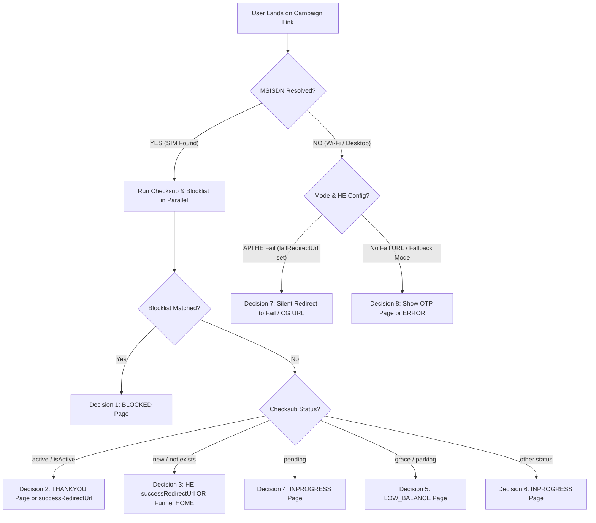

# 03 - Header Enrichment (HE) & The 8-Way Decision Matrix
## Automated SIM Identity Resolution & Landing Decision Engine

> **Purpose:** Ye document detail me explain karta hai ki Header Enrichment (HE) kaise kaam karta hai, 4 alag-alag HE providers kya hote hain, aur `/api/flow/detect-msisdn` ka **8-Way Decision Matrix** landing par user ko kahan route karta hai.

---

### 1. Header Enrichment (HE) Kya Hota Hai?

Jab koi user apne phone ke mobile network (3G / 4G / 5G / LTE mobile data) se internet use karta hai, toh Telecom Operator ke cellular gateway (GGSN / PGW) se pass hote waqt HTTP headers me user ka SIM number inject ho jata hai (jaise `x-msisdn`, `x-up-calling-line-id`, ya `x-fh-msisdn`).

Iska sabse bada fayda:
- **No Manual Typing:** User ko apna mobile number type nahi karna padta.
- **Instant 1-Click Subscribe:** User bina OTP ke sirf ek button dabake subscribe ho sakta hai.
- **Higher Conversion Rate:** Conversion rates 3% se badhkar 25%-40% tak pahunch jate hain.

Lekin agar user **Wi-Fi** par hai, toh koi telecom header nahi aata. WAP Manager is scenario ko seamlessly handle karta hai.

---

### 2. The 4 HE Providers Supported by WAP Manager

Campaign ke `api_configs.he_provider` me 4 alag-alag engines configure ho sakte hain:

```
                  ┌─────────────────────────────────────────┐
                  │          HE PROVIDER SELECTOR           │
                  └─────────────────────────────────────────┘
                                       │
        ┌───────────────┬──────────────┴───────────────┬────────────────┐
        ▼               ▼                              ▼                ▼
    [header]          [none]                    [custom_http]   [safaricom_masked]
Carrier Headers     Always Empty              Server-Side API    2-Step Token + Masked
(Direct SIM Data)  (Wi-Fi / Manual OTP)       Resolver HTTP      Browser Protocol
```

#### Provider Details Table:

| Provider | Kaam Karne Ka Tareeka | Phone Kahan Se Milta Hai? | Typical Use Case |
| :--- | :--- | :--- | :--- |
| `header` *(Default)* | Incoming request headers ko scan karta hai (`x-msisdn`, `msisdn`, `x-network-info`). | Request ke carrier HTTP headers se | Standard telco proxy headers (UAE, Iraq, Qatar, etc.) |
| `none` | HE check ko completely skip kar deta hai. | Kabhi resolve nahi hota | Wi-Fi campaigns ya strict OTP-only funnels |
| `custom_http` | Ek configured external server API endpoint ko hit karta hai jo IP/session se phone resolve karta hai. | **Sirf external API ke response se** | Special private operator proxy endpoints |
| `safaricom_masked` | 2-step browser protocol: pehle OAuth token leta hai, fir masked MSISDN fetch karta hai. | **Browser API response se** | Kenya Safaricom DSDP Gateway Integration |

#### Safaricom Masked Token Flow (Kenya Specific):
1. Browser frontend Safaricom ke token endpoint par request bhejta hai (`POST tokenUrl` with session ID).
2. Token milne ke baad browser Safaricom ke masked MSISDN endpoint ko hit karta hai (`GET maskedUrl` with `Bearer <token>`).
3. Browser ko masked MSISDN milta hai (e.g. `2547****1234`).
4. Browser ye phone humare backend `/detect-msisdn` ko bhejta hai taaki subscription aage badh sake.

---

### 3. The 8-Way Decision Matrix (`detectMsisdn`)

Jab user landing link open karta hai, toh backend `/api/flow/detect-msisdn` endpoint par **Checksub (Subscription Status)** aur **Blocklist (DND/Fraud)** check run karta hai. Uske baad system in 8 decisions me se kisi ek path par user ko bhejta hai:



#### Detailed Decision Rules:

| # | Condition | `nextPage` | Outbound Redirect URL | Action / Behavior |
| :--- | :--- | :--- | :--- | :--- |
| **1** | Phone Mila + Blocklist me number hai | `BLOCKED` | None | User ko clean blocked screen dikhao (Service not allowed). |
| **2** | Phone Mila + Checksub bola `active` | `THANKYOU` | `campaign.successRedirectUrl` (agar set ho) | User already subscribed hai! Direct content portal par bhej do ya Thank You dikhao. |
| **3** | Phone Mila + Checksub bola `new` | `HOME` *(agar URL empty)* | `heConfig.successRedirectUrl` *(agar set ho)* | Naya user hai. Agar external telco gateway URL diya hai toh wahan bhej do; warna 1-Click HOME screen dikhao. |
| **4** | Phone Mila + Checksub bola `pending` | `INPROGRESS` | None | Subscription bank/telco side process ho rahi hai. Waiting screen dikhao. |
| **5** | Phone Mila + Checksub bola `grace` / `parking` | `LOW_BALANCE` | None | User ke SIM me balance nahi hai. "Please recharge mobile balance" screen dikhao. |
| **6** | Phone Mila + Checksub bola unknown non-new | `INPROGRESS` | None | Status in progress screen par bhej do. |
| **7** | **Phone NAHI mila** (Wi-Fi) + API HE | None | `heConfig.failRedirectUrl` ya `campaign.cgRedirectUrl` | Silent exit! Wi-Fi user ko seedhe telco fallback gateway par bhej do. |
| **8** | **Phone NAHI mila** + Verification Mode `BOTH` / `OTP_ONLY` | `OTP` | None | User se phone number mango aur OTP flow start karo. |

---

### 4. Silent Exit vs Funnel Mode (No Flashing Guarantee)

Sabse badi user experience issue hoti hai **"Page Flash"** — yaani user Wi-Fi par ho, pehle use ek second ke liye HOME screen dikhe, aur fir achanak redirect ho jaye. 

WAP Manager me **Zero-Flash Lifecycle** implemented hai:

```
[User Open Link]
       │
       ▼
[Full Screen Clean Loading Overlay]
"Connecting securely to mobile network..."
       │
       ├──────────────────────────────────────────────┐
       ▼                                              ▼
[Silent Exit Path]                            [Funnel Display Path]
Conditions:                                   Conditions:
• Phone nahi mila & failRedirectUrl set hai    • Phone mil gaya & HE successUrl empty hai
• Phone mil gaya & successRedirectUrl set hai  • Wi-Fi user & Mode = OTP_ONLY / BOTH
       │                                              │
       ▼                                              ▼
Browser seedhe target URL par                  Overlay fade out hota hai aur
window.location.replace() karta hai.           Clean HOME / OTP screen render
HOME screen kabhi render hi nahi hoti!        hoti hai (Zero Glitch).
```

- **Boot Gate (`waitForHeDetect`):** Frontend maximum 12 seconds tak wait karta hai detect settling ke liye.
- Jab tak detect response confirm na ho jaye, HOME page ki HTML Shadow DOM me mount hi nahi hoti.
- Isse user ko kabhi flicker, incomplete button, ya wrong page glimpse nahi dikhti.
