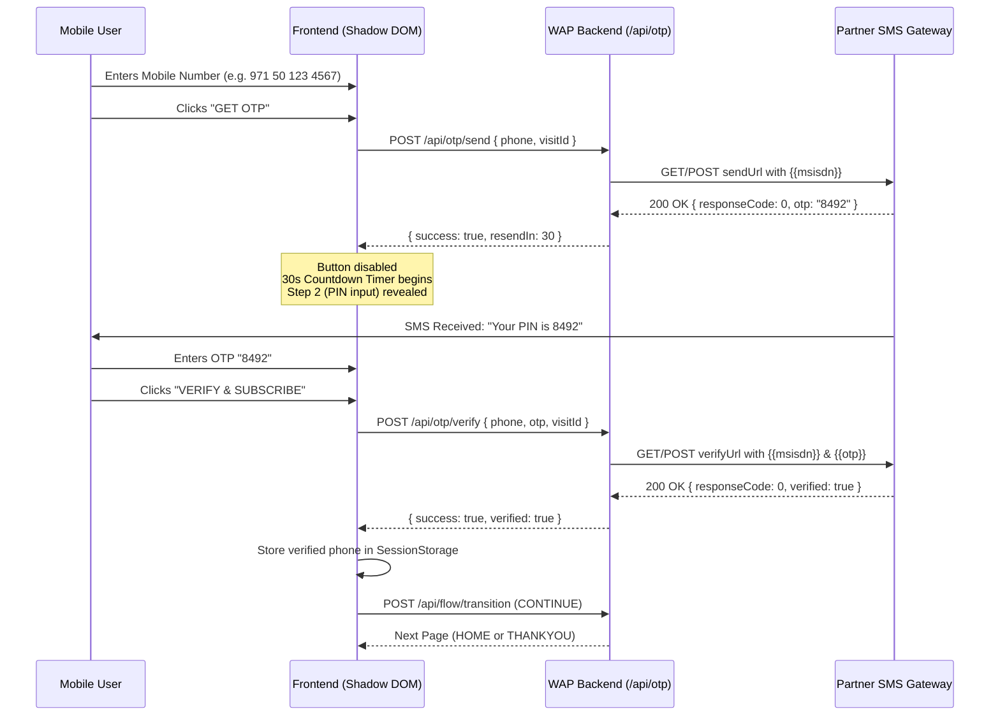

# 06 - Partner APIs, OTP Lifecycle & DCB Billing Execution
## Telecom HTTP Contracts, SMS Gateways & Balance Charging

> **Purpose:** Ye document WAP Manager ke partner integration layer, checksub/blocklist HTTP contracts, SMS OTP generation/validation rules, aur direct carrier billing (`subscribeApi`) execution ko detail me explain karta hai.

---

### 1. Partner API Configuration Schema (`api_configs`)

Har campaign ke paas ek linked `api_configs` record hota hai jo telecom partner ke saath HTTP communication ko manage karta hai:

```json
{
  "heProvider": "header",
  "subscriptionApi": "https://partner-telco.com/sub/checksub?msisdn={{msisdn}}&serviceId=WELLNESS",
  "blocklistApi": "https://partner-telco.com/sub/checkblock?msisdn={{msisdn}}",
  "subscribeApi": "https://partner-telco.com/sub/charge?msisdn={{msisdn}}&plan={{planId}}",
  "headersJson": "{\"Authorization\": \"Bearer SECRET_KEY\", \"Content-Type\": \"application/json\"}",
  "otpConfigJson": {
    "sendUrl": "https://partner-telco.com/otp/generate?msisdn={{msisdn}}",
    "verifyUrl": "https://partner-telco.com/otp/validate?msisdn={{msisdn}}&otp={{otp}}",
    "method": "GET",
    "verifyMethod": "GET",
    "successKey": "responseCode",
    "successValue": "0"
  }
}
```

---

### 2. Checksub & Blocklist Execution Contracts

Jab `/api/flow/detect-msisdn` run hota hai, toh backend user ke phone number par parallel HTTP calls fire karta hai:

```
                  ┌──────────────────────────────┐
                  │      RESOLVED MSISDN         │
                  └──────────────────────────────┘
                                  │
                 ┌────────────────┴────────────────┐
                 ▼                                 ▼
      [1. CHECKSUBSCRIBE HTTP]            [2. BLOCKLIST HTTP]
   GET /checksub?msisdn=97150123...    GET /checkblock?msisdn=97150123...
                 │                                 │
                 ▼                                 ▼
         [Normalize Status]               [Check Fraud / DND]
      • active / isActive                  • Matched -> BLOCKED
      • new / not_exists                   • Clean  -> Allowed
      • grace / parking
      • pending
```

#### Status Normalization Rules:
* Telco response formats differ (kuch JSON me `status: "ACTIVE"` bhejte hain, kuch `result: 1`, kuch `code: 200`).
* System ka normalizer common status strings me convert karta hai:
  - `active` / `isActive: true` -> User already subbed -> **Decision 2: THANKYOU / Success Redirect**.
  - `new` / `serviceNotExists` / empty -> User eligible -> **Decision 3: Funnel continue**.
  - `grace` / `parking` -> User balance zero -> **Decision 5: LOW_BALANCE**.
  - `pending` -> Charge processing -> **Decision 4: INPROGRESS**.

---

### 3. SMS OTP Complete Lifecycle

Jab user Wi-Fi par hota hai ya mode `OTP_ONLY` hota hai, toh SMS OTP verification pipeline start hoti hai:



#### OTP Safeguards & Business Logic:
1. **Resend Cooldown (30 Seconds):**
   - Jab user "GET OTP" dabata hai, button turant disable ho jata hai aur 30 second ka countdown shuru hota hai.
   - User 30s se pehle dubara SMS trigger nahi kar sakta (SMS spam aur cost prevent karne ke liye).
2. **Maximum Resend Limit (5 Attempts):**
   - Agar user 5 baar resend kar chuka ho, toh button permanently disable ho jata hai with message: *"Maximum resend attempts reached. Please try again later."*
3. **Development OTP Preview:**
   - Local testing aur sandbox environment me backend response me `devOtpCode` include kar deta hai taaki testing ke waqt real SMS ka wait na karna pade.
4. **Phone Formatting:**
   - User kisi bhi format me number daale (`050 123 4567` ya `+971 50...`), frontend aur backend use international E.164 format me clean karte hain country prefix ke saath (`971501234567`).

---

### 4. Direct Carrier Billing (DCB) Execution (`subscribeApi`)

Jab user subscription approve karta hai (1-Click HE button, Confirm button, ya verified OTP transition):

1. **Attribution Pre-Lock:**
   - System billing call karne se pehle `registerPending()` call karke conversion record ko status `pending` me lock karta hai.
2. **Telco Billing HTTP Request:**
   - Backend partner ke configured `subscribeApi` par request bhejta hai.
   - Request variables jaise `{{msisdn}}`, `{{serviceId}}`, `{{subServiceId}}`, `{{planId}}` dynamically replace hoti hain.
3. **Response Handling:**
   - **Case A (Success):** Operator balance deduct karta hai aur success code bhejta hai. System pending conversion ko promote karke ad network ko S2S Postback fire karta hai aur frontend ko `THANKYOU` page render karta hai.
   - **Case B (Insufficient Balance):** Operator low balance return karta hai. Frontend redirect hokar `LOW_BALANCE` screen dikhata hai.
   - **Case C (Blocked / Limit Exceeded):** System `BLOCKED` ya `ERROR` screen par route kar deta hai.
